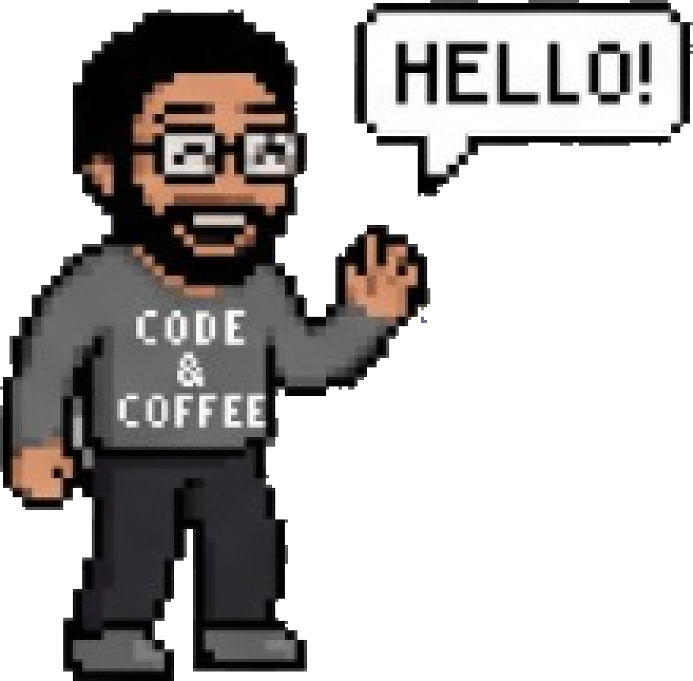

## Saïd Amokrane Belgacem, aka Amodias

### A full stack software engineer

I build cross-platform solutions for web, desktop and mobile. Focused on building scalable and user-friendly software.

**Simple, efficient and scalable.**

- 🟢 Available for new projects · Remote
- 🔭 I’m currently shipping products with Laravel, React, TypeScript and Electron
- 💬 Ask me about offline-first apps, from the API to the screen people actually use
- 😄 I use AI to move faster, without falling into vibecoding
- ⚡ Fun fact: the first sprint is a coffee run
- 📍 Oran, Algeria

<br clear="right" />

```text
$ php artisan test
✓ all tests passed

$ git push origin Master
```

### Stack

[](https://laravel.com)
[](https://www.php.net)
[](https://www.mysql.com)
[](https://react.dev)
[](https://www.typescriptlang.org)
[](https://nextjs.org)
[](https://www.electronjs.org)
[](https://reactnative.dev)
[](https://git-scm.com)
[](https://www.cloudflare.com)
[](https://www.kernel.org)

### Featured work

**[Talyo](https://www.amodias.dev/#work)** — Business management CRM  
Customers, sales and inventory, with an offline point of sale that stays synchronized.  
`Laravel` `React` `TypeScript` `Electron`

**[Gym Jarvis](https://gymjarvis.amodias.dev)** — 3D anatomy trainer  
A 3D muscle map. Click a muscle to see the exercises that train it, and preview the movement.  
`React` `TypeScript` `Three.js`

**[HakimPilote](https://www.amodias.dev/#work)** — Clinic workstation  
Patients, the waiting room, medicines and prescriptions. Offline, printable, and live chat with the secretary.  
`Electron` `React` `TypeScript` `SQLite`

Problem solver · Team player · Continuous learner

Arabic (native) · Kabyle (native) · French (fluent) · English (B2) · Spanish (basic)

[amodias.dev](https://www.amodias.dev) · [GitHub](https://github.com/Amodias) · [LinkedIn](https://www.linkedin.com/in/sa%C3%AFd-amokrane-belgacem-a42222253) · [saidamokranebelgacem@gmail.com](mailto:saidamokranebelgacem@gmail.com) · [+213 78 273 43 98](tel:+213782734398)
